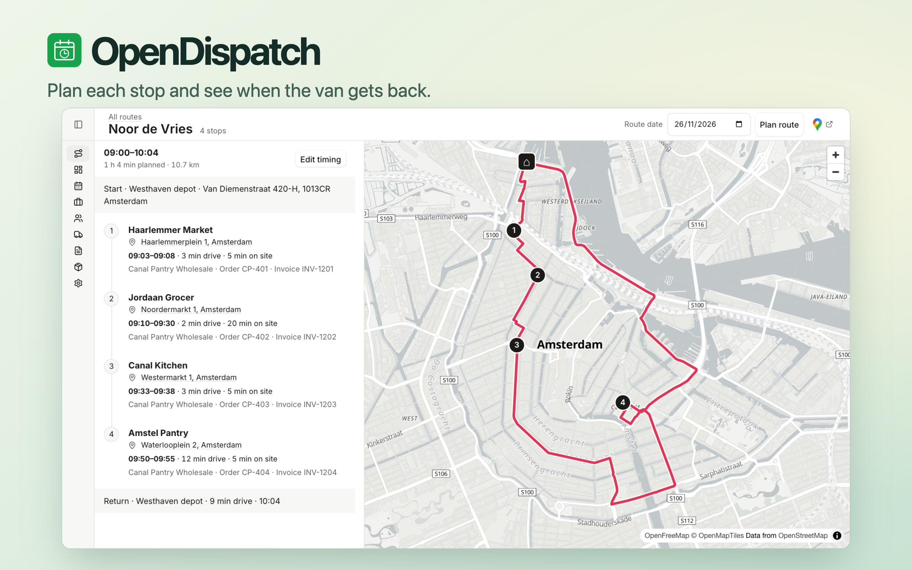
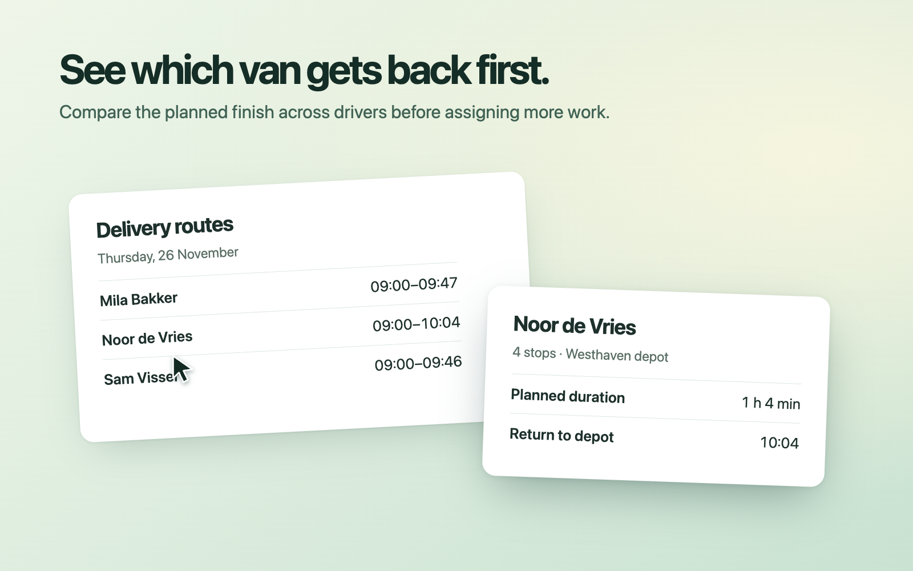
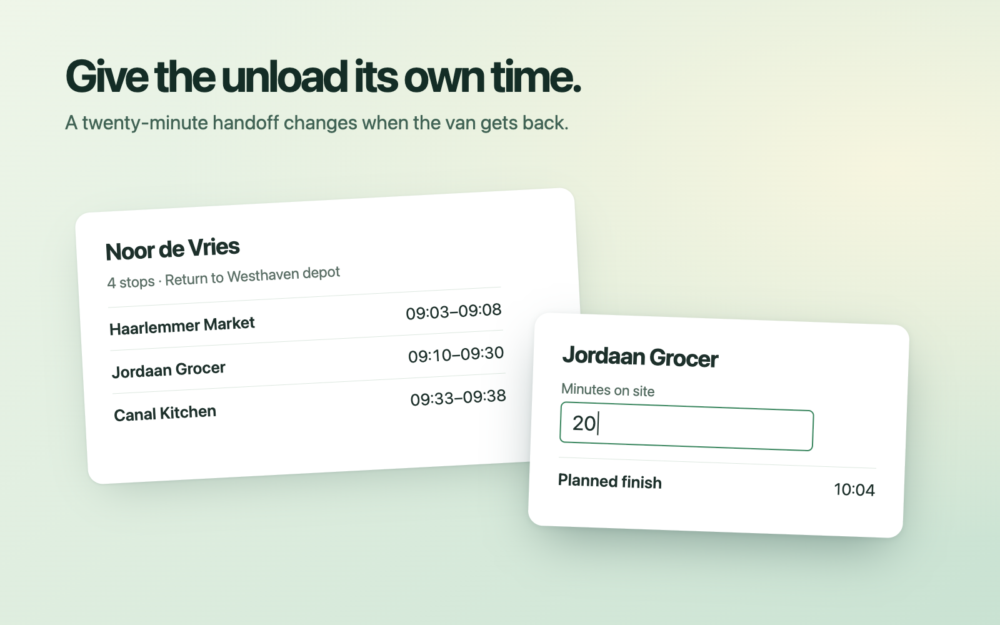
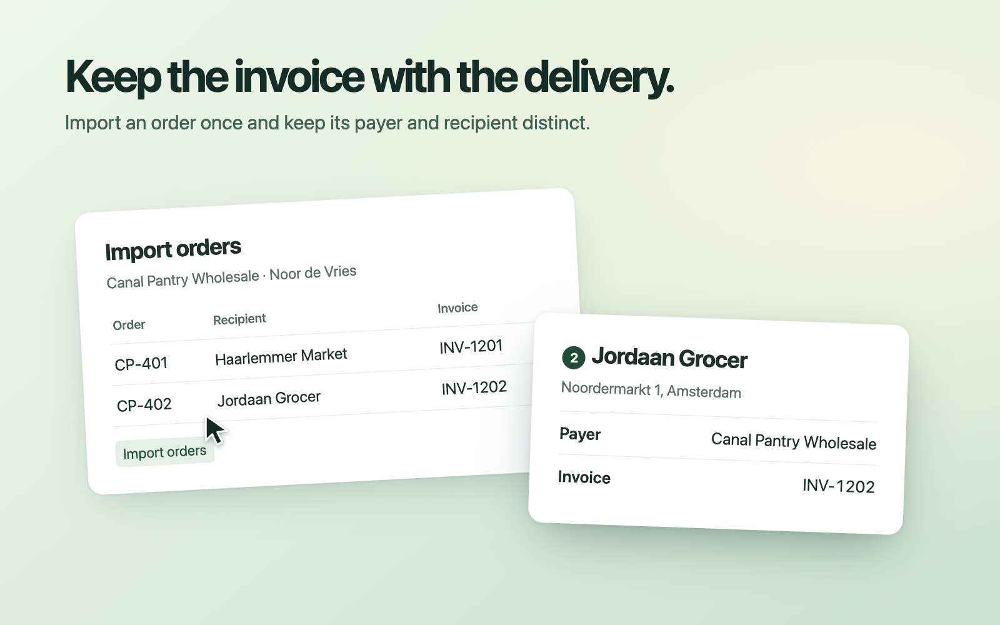
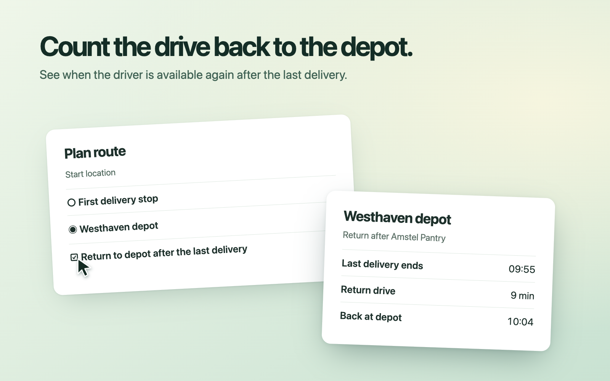

<picture>
  <source media="(prefers-color-scheme: dark)" srcset="readme-banner-dark.png">
  
</picture>

# OpenDispatch: The Open-Source Onfleet Alternative

OpenDispatch helps couriers, distributors and wholesalers plan a day’s deliveries in their own vans. Import orders, see each driver’s stops on a road map, and plan when the van will be available again. Each order keeps its paying customer, recipient and original invoice reference.

## See it in action

Select an illustration to see the fictional delivery run in detail.

| Compare driver schedules | Adjust a stop’s service time |
| --- | --- |
|  |  |
| **Import an order with its invoice** | **Plan the return to the depot** |
|  |  |

## Current implementation

This first revision carries over the back office from [OpenFieldService](https://github.com/clawnify/OpenFieldService/tree/2cf5cd77dd8996caa92158504c059b77d206883e), including customer records, staff assignments, scheduling, invoices and saved read-only job packets. The inherited screens still use field-service terminology.

Open Delivery routes, choose a date, then select **Import orders** and choose the paying customer and driver. Paste spreadsheet rows containing the order reference, recipient, address and optional external invoice reference. The overview lists the drivers and their planned finish times. Opening a driver’s route shows its stops in delivery order. A duplicate reference for the same payer rejects the entire import. Importing a manifest preserves existing invoice references without creating an invoice. Subsequent work covers revocable driver links, offline photo and signature capture, single-van route optimization, recipient tracking and delivery billing. Those features are planned.

## Route maps

Each driver route opens in Google Maps in dispatch order. Select an address to navigate from your current location. Saved road plans appear on an interactive MapLibre map. For a Google Maps embed on routes without a saved road plan, set `GOOGLE_MAPS_EMBED_BROWSER_KEY` to a dedicated browser key restricted to the Maps Embed API and the app’s website origin. This key is visible in the browser. Longer routes open in consecutive sections.

### Depots and planned distance

On a route, choose **Plan route**. Start at the first delivery or save a named depot with its street address and entrance coordinates (latitude, longitude). Choose whether the van returns there. Each route keeps the depot it started with. Depots do not count as deliveries. For newly imported addresses without saved pins, the planner asks for their coordinates once.

Saving sends the ordered coordinates to an OSRM driving service and stores the road line, distance and driving time for each leg together. The local Wrangler configuration uses the public demonstration router. For deployment, set `OSRM_BASE_URL` to your own OSRM driving service or a compatible managed endpoint. Opening an existing plan uses the saved route. Adding stops makes its old distance unavailable until the plan is recalculated.

### Arrival and departure times

Choose **Edit timing** to set the route departure, default minutes on site and any exceptions for individual stops. An earliest service time allows for waiting. The itinerary shows driving time, time on site and when the driver leaves each customer. A return to the depot counts toward the finish. These are planning estimates. Recalculate older distance-only routes once to add driving times.

## Local development

Use Node.js 22 and pnpm. Run `pnpm install --frozen-lockfile`, then `pnpm dev` to initialize the local database and start the UI and API. Run `pnpm test` for the inherited regression suite and `pnpm build` for the production frontend.

## License

MIT. See [LICENSE](LICENSE).
